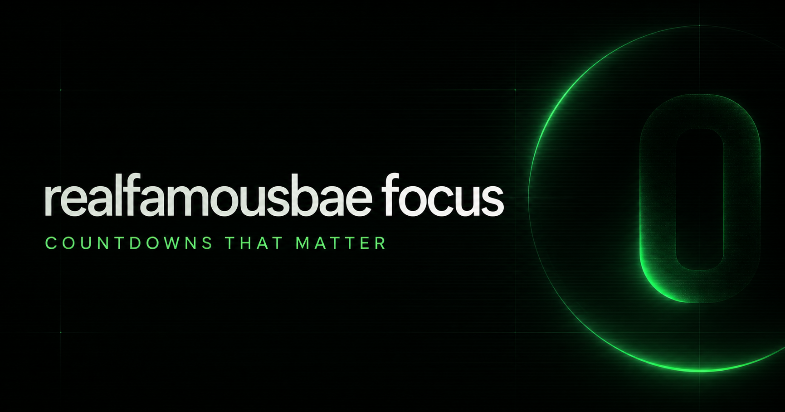

# realfamousbae focus

Beautiful, private countdowns for the moments that matter. Create a timer, keep it synchronized across devices with a username and password, or bring in a calendar in a couple of clicks.

**Website:** deployed on Railway



## What it does

- Creates live countdown timers with optional notes and color accents.
- Keeps timers private to the signed-in user and syncs them through Postgres.
- Imports upcoming events from `.ics`, `.ical`, and Google Calendar `.csv` files.
- Handles recurring calendar events, exclusions, duplicates, time zones, and a one-year import horizon.
- Offers Russian and English interfaces, with the preferred language remembered locally.

## Stack

Next.js 16 · React 19 · TypeScript · Vinext/Vite · Postgres · Drizzle ORM · Railway

## Run locally

Requires Node.js 22.13 or later.

```bash
npm install
npm run dev
```

Useful checks:

```bash
npm test
npm run lint
npm run build
```

Environment variables:

- `DATABASE_URL` — Postgres connection string (tables are created on first request).
- `SESSION_SECRET` — random string (32+ chars) used to sign session cookies.
- `ALLOW_REGISTRATION` — set to `false` to close sign-ups (default: open).
- `NEXT_PUBLIC_SITE_URL` — public site URL, used for metadata.

## Data and privacy

Each timer is stored with its authenticated owner ID. API routes require a signed-in session, and all timer queries are scoped to that owner.

## Project layout

```text
app/        UI, authentication helpers, and timer API routes
db/         Drizzle schema and D1 access
drizzle/    Database migration history
public/     Brand and social-preview assets
```

## License

[MIT](LICENSE) © 2026 realfamousbae
